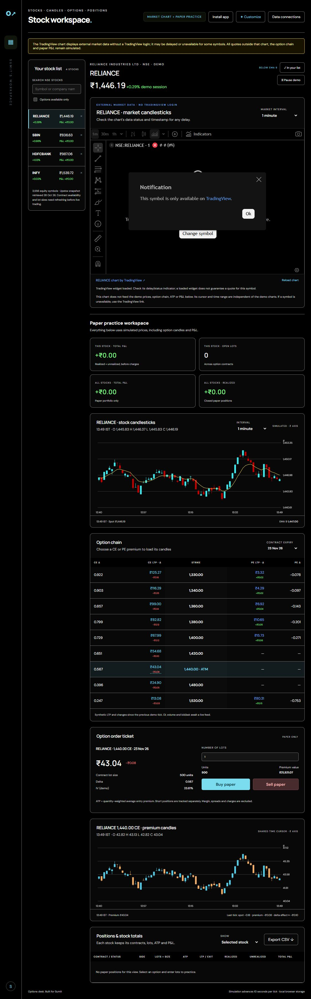
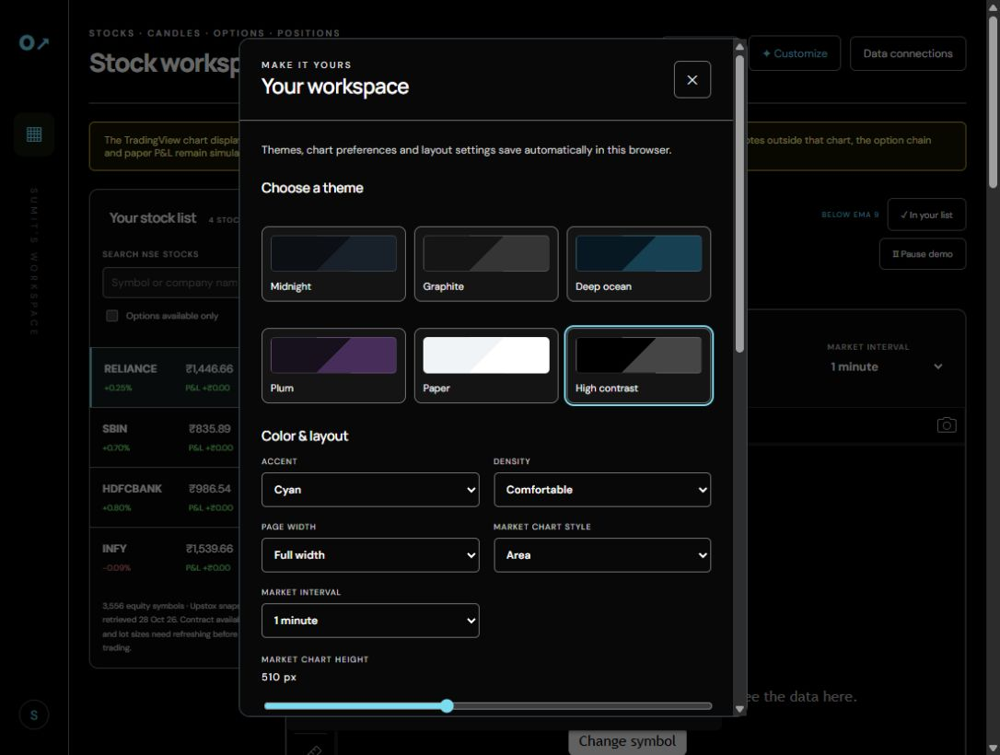

# Options Desk

### A personal NSE stock and options workspace, created by Sumit Sarkar (@MitsuSarkar)

I made Options Desk to bring stock charts, option premium candles, contract selection, and paper positions into one customizable app. It helps me explore how underlying prices and option premiums move together and practice working with lots, average entry prices, and P&L.

**Current release: an installable paper-trading web app.** Custom quotes and option chains are simulated. Live broker connectivity and automated trade recommendations are not implemented. This app does not promise profits.



## What you can do

- Search an NSE equity catalogue and build a personal stock watchlist.
- Select available expiries, strikes, calls (CE), and puts (PE) from the instrument snapshot.
- Compare stock and option premium candlesticks with synchronized practice-chart cursors and 1/5/15-minute intervals.
- View an EMA 9 overlay and illustrative option delta and IV.
- Practice buy and sell entries in lots, track quantity-weighted ATP, and inspect realized and unrealized P&L.
- Keep separate positions for different stocks and export the paper portfolio to CSV.
- Choose themes, accents, layout density, chart height, and separate rising/falling candle colors for stocks and premiums.
- Install the app in a standalone browser window and use cached practice features offline after the first successful load.

## Start locally

Install Node.js, download or clone this repository, then run from its folder:

```sh
node server.cjs
```

Open **http://127.0.0.1:4173/** in Edge or Chrome. No npm dependencies or build step are needed.

On Windows, right-click **Start-OptionsDesk.ps1** and run it with PowerShell to start the server and open an Edge app window. Alternatively, run it from PowerShell:

```powershell
.\Start-OptionsDesk.ps1
```

Use **Install app** or your browser's installation menu for a standalone installed web app. This is a progressive web app, not a packaged Windows executable. The local server is needed for initial loading and updates; external market charts always require internet.

## How to use it

1. Search for a stock, optionally filter to stocks with option contracts, and add it to your list.
2. Select the stock to load its practice charts and available option contracts.
3. Choose an expiry, then click a CE or PE premium in the option chain.
4. Inspect the selected premium candles, contract lot size, delta, and illustrative IV.
5. Enter a number of lots and choose **Buy paper** or **Sell paper**. These buttons only create simulated positions.
6. Track ATP and P&L under **Positions & stock totals**, switch between one stock and all stocks, or export CSV. Closing realizes the entire paper position.
7. Open **Customize** to change themes, panel visibility, and the stock/premium candle colors. Changes save automatically in this browser.



Watchlists, positions, and preferences are stored locally in the browser. Use the same browser profile and exact URL each time: localhost and 127.0.0.1 have separate storage. Clearing site data removes saved workspace data.

## Connect your own API for live option chains

You can extend this app with your own broker or licensed market-data API. **This release does not have a working API-key connection form or a ready-made live adapter.** Adding a key alone will not enable live data; you must implement a backend and connect the frontend to it.

See [the live API integration guide](docs/LIVE-API.md) for the architecture, required data, and files to change. Bring your own provider account and confirm its NSE F&O entitlements and permitted data use.

## Market data and limits

| Component | Current behavior |
| --- | --- |
| Stock and option practice prices | Synthetic simulation |
| Option delta and IV | Illustrative pricing model inputs/outputs |
| Symbols, expiries, lot sizes | Downloaded instrument snapshot; refresh before live use |
| Embedded TradingView chart | Independent external widget; symbols may be unavailable or delayed |
| Paper P&L | Excludes brokerage, taxes, slippage, spreads, and margin |
| Real orders / broker synchronization | Not implemented |
| Profit forecasts / entry and exit signals | Not implemented |

The embedded market chart cannot provide prices to the option chain or paper accounting. NSE symbols may be unavailable in TradingView's embed; the direct TradingView link remains available. Do not interpret a loaded widget as verified live NSE data.

## Project structure

- **dist/** — browser app, pricing engine, instrument catalogue, themes, manifest, and offline service worker.
- **server.cjs** — minimal local static server.
- **Start-OptionsDesk.ps1** — Windows app-window launcher.
- **build-catalog.cjs** — instrument catalogue generation.
- **verify.cjs** — pricing, accounting, candle, and UI interaction smoke checks.
- **docs/** — screenshots, technical notes, and live integration guidance.

Run checks with `node verify.cjs`. See [implementation details](docs/IMPLEMENTATION.md) for pricing assumptions, data sources, storage behavior, and limitations.

## Credits

Created by **Sumit Sarkar (@MitsuSarkar)**, with development assistance from OpenAI Codex. Instrument catalogue source: Upstox public NSE instrument snapshot. External chart widget: TradingView, with its branding retained. No broker or exchange endorsement is implied.
